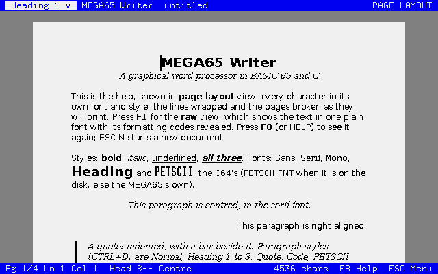
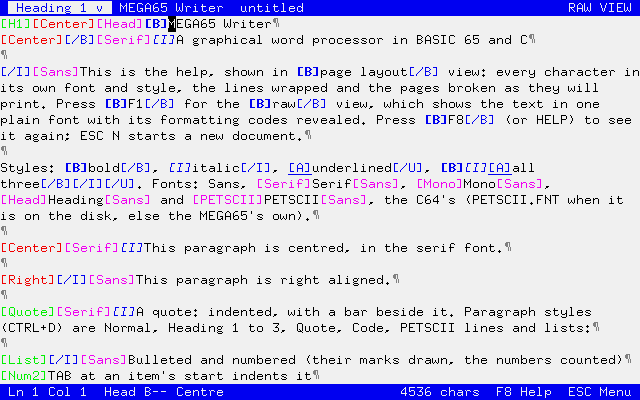
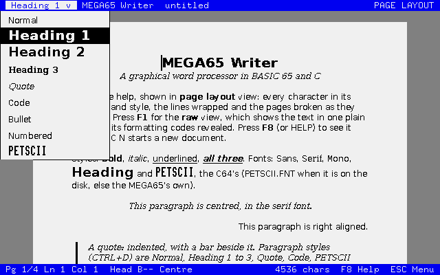
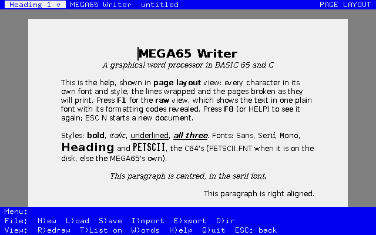
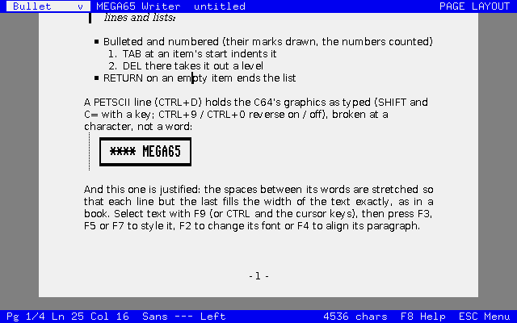
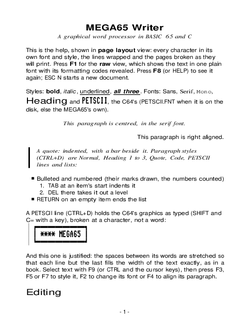

# MEGA65 Writer

A graphical word processor for the MEGA65, written in BASIC 65 and C.
Text is shown on a 640 × 400 bitmap in proportional fonts, so what you see
is how it will look on the page.

For how it is built and how it works inside, see [NOTES.md](NOTES.md).

## Features

- **Two views.**
  - **Page layout** shows the document WYSIWYG: words wrapped, paragraphs
    aligned, US Letter pages with margins, page breaks and page numbers.
  - **Raw view** shows the text in one plain 80-column font, with the
    formatting codes as coloured tags (`[B]`, `[Serif]`, `[Center]`, ...)
    and paragraph marks (¶).
  - You can edit in either view.
- **Fonts and effects.**
  - Fonts: Sans, Serif, Mono, Head and PETSCII (the C64's glyphs).
  - Effects: bold, italic, underline, strikethrough, superscript and
    subscript.
- **Paragraph styles:** Normal, Heading 1–3, Quote (indented, with a bar),
  Code, bulleted and numbered lists (four levels, renumbered as you edit),
  and PETSCII lines.
- **PETSCII lines** hold C64 graphics as typed (SHIFT and C= with a key),
  with reverse video.
- **Named styles:** up to 16 character styles of your own, saved with the
  document. Redefine one and all its text changes.
- **Alignment:** left, centre, right and justified.
- **Editing:**
  - selection, copy, cut and paste;
  - undo and redo;
  - find and replace;
  - page breaks.
- **Accented characters:** type any Latin-1 character with a two-key
  Compose sequence.
- **Files:**
  - Writer's own format keeps every font and style.
  - Import and export: PETSCII text, Markdown, RTF and HTML.
  - Export to PDF, using the standard PDF fonts, with PETSCII drawn from
    the C64 glyphs.
- **Word count:** words, characters and paragraphs, of the selection or
  of the whole document.
- **List mode:** shows spaces, paragraph ends, wrapped lines and trailing
  spaces.
- **Built-in help:** a Writer document, shown at the start and with F8.

## Screenshots

Taken in xemu, from the help document Writer shows at its start.

| Page layout | Raw view (F1) |
|---|---|
|  |  |
| **Style drop-down (CTRL+D)** | **Menu (ESC)** |
|  |  |
| **Lists, a PETSCII line, justified text** | **PDF export (page 1, exported on the MEGA65)** |
|  |  |

## Getting started

**Requirements:** a MEGA65 with attic RAM (the 8 MB HyperRAM). Without it,
Writer stops at the start with "No attic RAM." The xemu emulator works too.

**Running it:**
1. Copy `writer.d81` to the SD card and mount it.
2. Type `DLOAD "WRITER"`, then `RUN`.

To build it yourself, see [NOTES.md](NOTES.md#building-and-running).

### The disk

| File | What it is | Required |
|---|---|---|
| `WRITER` | the program | yes |
| `WRITER.OV1` | more of the program's code | yes |
| `WRITER.FNT` | the fonts | yes |
| `WRITER.MSG` | the messages, menu and prompts | yes |
| `DEFAULT0.OVL` | undo, find and replace, and the styles | yes |
| `WRITER.HELP` | the help | no |
| `MARKDOWN.OVL`, `MDIN.OVL` | Markdown export, import | no |
| `RTF.OVL`, `RTFIN.OVL` | RTF export, import | no |
| `HTML.OVL`, `HTMLIN.OVL` | HTML export, import | no |
| `PDF.OVL`, `PDF2.OVL` | PDF export (it needs both) | no |
| `LIST.OVL` | list mode | no |
| `PETSCII.FNT` | a C64 character set you add yourself | no |

### Freeing disk space

You can delete any of the optional files. The rest of Writer still works;
only that file's feature is gone.

| Deleted | What is no longer available |
|---|---|
| `MARKDOWN.OVL` | export to `.md` |
| `MDIN.OVL` | import from `.md` |
| `RTF.OVL` | export to `.rtf` |
| `RTFIN.OVL` | import from `.rtf` |
| `HTML.OVL` | export to `.htm` / `.html` |
| `HTMLIN.OVL` | import from `.htm` / `.html` |
| `PDF.OVL` or `PDF2.OVL` | export to `.pdf` |
| `LIST.OVL` | list mode (the menu no longer offers T) |
| `PETSCII.FNT` | the C64 glyphs: the PETSCII font and PETSCII lines use the MEGA65's own character set |
| `WRITER.HELP` | the help: Writer starts with an empty document, and H / F8 say the help is not on the disk |

If a converter is missing, Writer says so when you use that kind of file
name. The largest are `MDIN.OVL`, `HTMLIN.OVL` and `PDF.OVL`, about 6 KB
each.

## Keys

| Key | Action |
|-----|--------|
| cursor keys | move |
| HOME / CLR | line start or end / document start or end |
| F13 / F14 | page up / down |
| DEL / INST | delete left / right |
| F1 | page layout / raw view |
| F2 | font: Sans, Serif, Mono, Head, PETSCII |
| F3 / F5 / F7 (or CTRL+B / CTRL+I / CTRL+U) | bold / italic / underline |
| F4 | alignment: left, centre, right, justify |
| F6 | page break |
| CTRL+D | paragraph style drop-down |
| CTRL+E | font and effect pop-up (strikethrough, superscript, subscript too) |
| SHIFT+CTRL+S | named styles pop-up |
| F9 | start / end a selection |
| CTRL + cursor keys | start or extend a selection |
| F10 / F11 / F12 | copy / cut / paste |
| CTRL+Z | undo; again: redo |
| CTRL+F | find |
| SHIFT+CTRL+F / SHIFT+CTRL+B | find the next / the previous |
| CTRL+H | find and replace: Y)es, N)o or A)ll at each match |
| CTRL+W | save under the document's name |
| CTRL+A | Compose an accented character (below) |
| CTRL+9 / CTRL+0 | reverse video on / off (in a PETSCII line) |
| TAB / DEL at a list item's start | indent / outdent it |
| CTRL+L | redraw the screen |
| F8 or HELP | the help |
| ESC | the menu (below); also ends a selection |

Styles and fonts apply to the selection, or to what you type next.

### Menu (ESC)

| Key | Command |
|-----|---------|
| N | new document |
| L / S | load / save a Writer document |
| I | import: PETSCII text; Markdown (`.md`), RTF (`.rtf`), HTML (`.htm`, `.html`) |
| E | export: as import, plus PDF (`.pdf`) |
| D | disk directory |
| R | redraw the screen |
| T | list mode on / off |
| W | count words, characters and paragraphs |
| H | the help |
| Q | quit |

### Paragraph styles (CTRL+D)

Use the cursor keys and RETURN, or press the style's key.

| Key | Style | Key | Style |
|-----|-------|-----|-------|
| N | Normal | C | Code |
| 1 / 2 / 3 | Heading 1 / 2 / 3 | B | Bulleted list |
| Q | Quote | # | Numbered list |
| P | PETSCII line | ESC | close |

### Named styles (SHIFT+CTRL+S)

| Key | Action |
|-----|--------|
| RETURN | apply the highlighted style |
| N (or "New style...") | name the selection's look as a new style |
| R | redefine the highlighted style as the selection's look |
| D | delete the name (the text keeps its look) |
| ESC | close |

### Accented characters (CTRL+A)

Press CTRL+A, then two characters in either order.

| Type | For | Type | For |
|------|-----|------|-----|
| `"a` `'e` `` `e `` `^o` `~n` | ä é è ô ñ (any letter that has it, capitals too) | `,c` `oa` | ç å |
| `ss` `ae` `AE` `o/` | ß æ Æ ø | `<<` `>>` `??` `!!` | « » ¿ ¡ |
| `co` `ro` `L-` `Y=` `c/` | © ® £ ¥ ¢ | `oo` `+-` `xx` `:-` `mu` | ° ± × ÷ µ |
| `12` `14` `34` `1^` `2^` `3^` | ½ ¼ ¾ ¹ ² ³ | `so` `PP` `..` | § ¶ · |
| `a_` `o_` `th` `d-` | ª º þ ð | two spaces | a no-break space |

`` ` `` is SHIFT+@.

## Limits

- 30000 characters (about 5000 words) per document.
- A 2560-character clipboard.
- Imported text up to 14 KB; Markdown up to 59 KB.
- PDF export up to about 7–10 text-heavy pages.
- One level of undo, up to 7500 characters.
